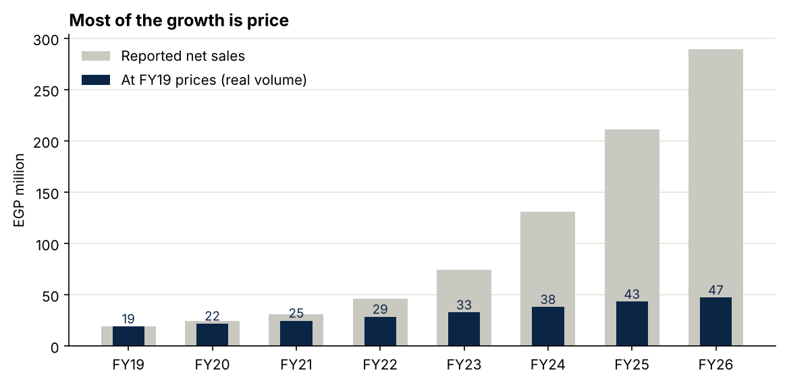
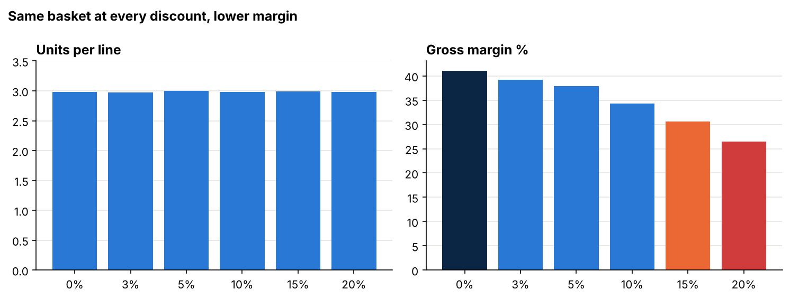
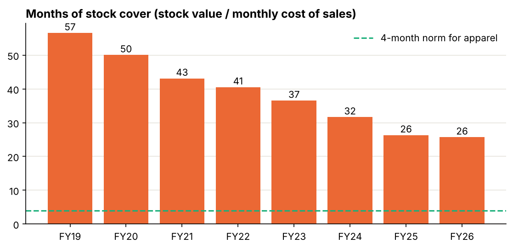
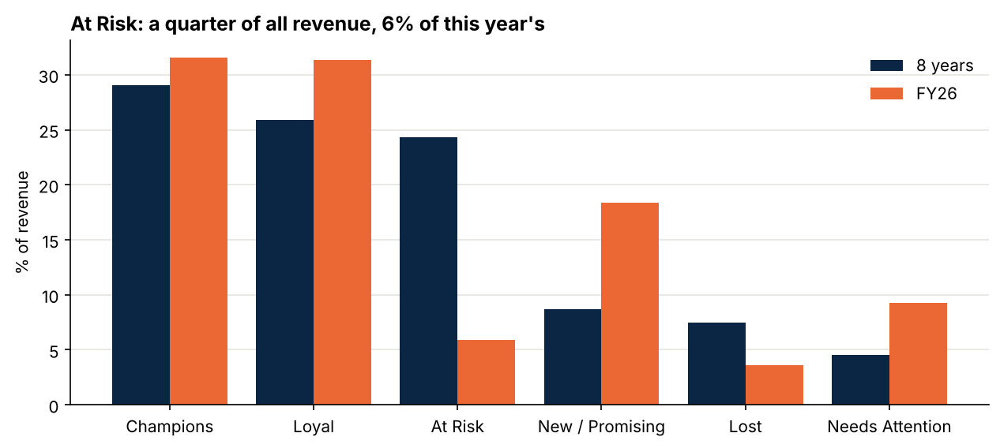
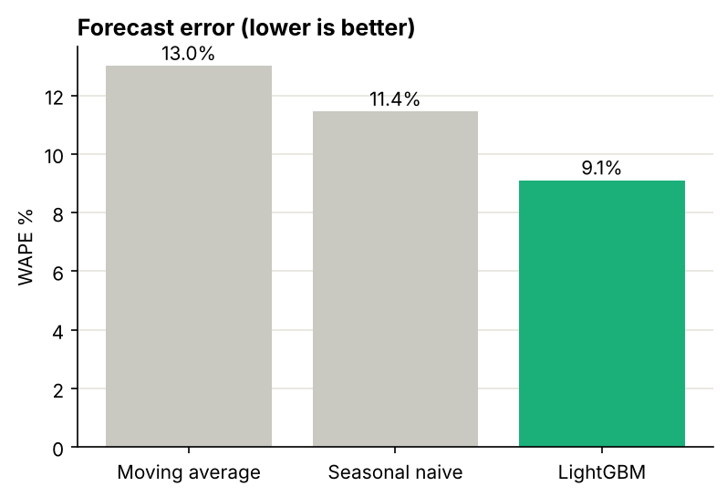
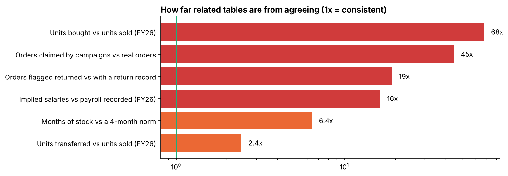
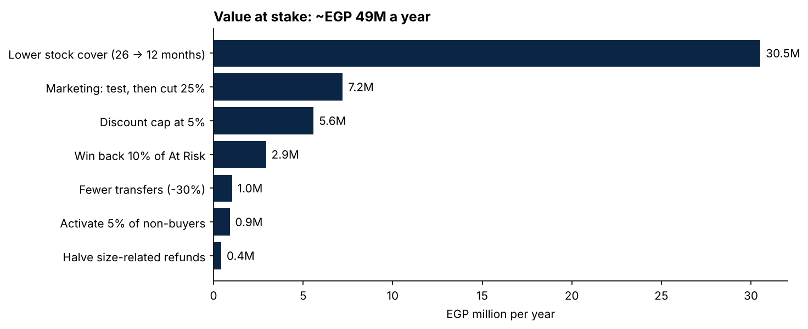

# Cottonil · Sales, Customers & Demand Forecasting

My analysis for **HVIA Task 3**: eight years (FY19 to FY26) of Cottonil data across 24 tables: sales, customers, branches, stock, transfers, purchasing, imports, costs and marketing.

The starting question: Cottonil's net sales grew **15x** in seven years. How much of that is real, and where is the value now?



## Key findings

**1. Most of the growth is price**
- Net sales: EGP 19.2M (FY19) → EGP 289.2M (FY26), **15.1x**
- Average price **6.1x**, units sold only **2.5x**
- Real growth (sales re-valued at FY19 prices): **13.7% a year**, and +9.2% in FY26 (vs +37% nominal)

**2. Discounts don't change what people buy**
- 2.98 units per line at 0%, 5%, 10% or 20% off (correlation 0.0004)
- Margin drops from 41% to 26% at the 20% level
- Capping routine discounts at 5% → about **+EGP 5.6M** gross profit a year



**3. About 26 months of stock**
- EGP 382M of stock at cost, 83% in warehouses
- Going down to 12 months would free **EGP 204M** of cash



**4. Customers**
- 87% of buyers come back, but 16,745 "At Risk" customers made 24% of all revenue and only 6% of FY26
- 10,340 registered customers never bought
- Branches are concentrated in Cairo (192 customers per branch) while Red Sea, Matrouh and Qena have ~4,000 per branch



**5. Demand forecast**
- LightGBM model for 48 series (16 categories × 3 channels), tested on 5 rolling backtests
- Error (WAPE) **9.1%** vs 13.0% for a moving average and 11.4% for seasonal naive
- Next 6 months: ~338K units (+8.5%)



**6. Marketing**
- Campaigns claim 24.1M orders; there are 540K real orders
- Measured against the other governorates in the same weeks, the median extra lift is **+0.5%**, which is no clear effect

**7. Data reality check**

The sales tables are clean, but several tables around them don't match sales:



**Total value at stake: ~EGP 49M a year** (FY26 base) + EGP 204M one-off cash from lower stock.



## Notebooks

| Notebook | What's in it |
|---|---|
| `01_sales_and_growth.ipynb` | Price vs volume, channels, categories, seasonality, discounts, returns |
| `02_customers_and_stores.ipynb` | Customer base, RFM segments, cohort retention, customers vs branches |
| `03_inventory_and_supply.ipynb` | Stock cover, transfers, purchase orders, imports |
| `04_demand_forecast.ipynb` | Features, 3 methods, backtest, 6-month forecast |
| `05_costs_and_marketing.ipynb` | Operating view, campaign claims vs measured lift |
| `06_data_checks_and_value.ipynb` | Cross-table checks and value at stake |

`utils.py` has the few helpers the notebooks share (loading files, fiscal year, chart style).

The full report (Word) and the summary slides (PDF) are in `report/`.

## How to run

```
pip install -r requirements.txt
```

Put the 24 CSV files from the HVIA package in `data/` (they're not in this repo), then run the notebooks in order.

The fiscal year runs October to September, so FY26 = Oct 2025 to Sep 2026.

## Notes

- Most of the data is modeled training data from HVIA, so the numbers are estimates. The patterns and the method are what matter.
- Some tables are on a very different scale from sales (purchases, marketing attribution, payroll), so they're reported as data issues instead of being used for decisions.

Tools: Python, pandas, NumPy, matplotlib, LightGBM
